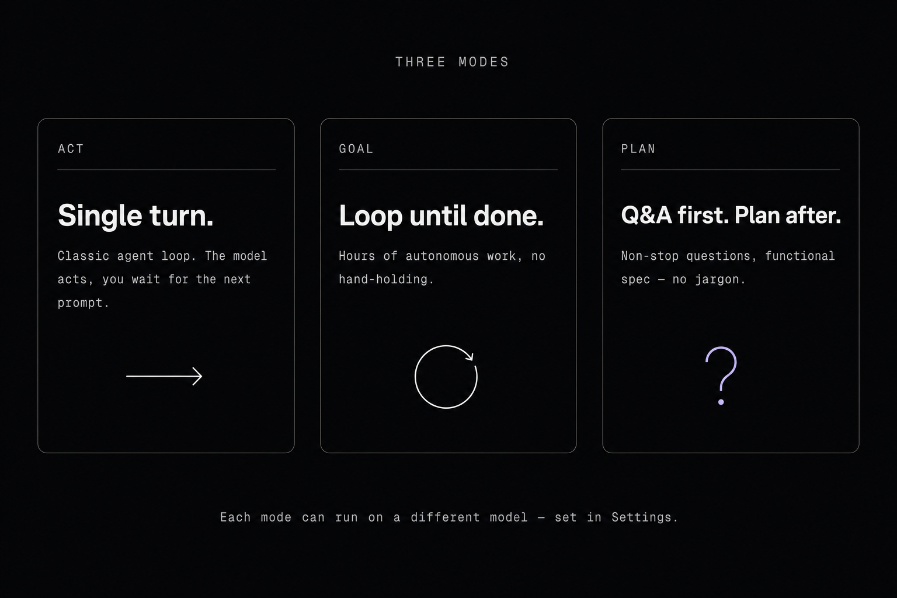

<p align="center">
  
</p>

<p align="center">
  <a href="https://github.com/WilliamPeynichou/ClaakeCode/releases/latest"></a>
  <a href="./LICENSE"></a>
  <a href="https://github.com/WilliamPeynichou/ClaakeCode/actions"></a>
  <a href="https://github.com/WilliamPeynichou/ClaakeCode/releases"></a>
</p>

<p align="center">
  <b>Claake Code</b> is a desktop AI coding harness you can reshape.<br/>
  Every tool is toggleable, every description is editable, every provider is pluggable.
</p>

<p align="center">
  <a href="https://github.com/WilliamPeynichou/ClaakeCode/releases/latest"><b>⬇ Download</b></a> ·
  <a href="#tools"><b>📖 Docs</b></a> ·
  <a href="https://claakecode-web.vercel.app/"><b>🌐 Site</b></a>
</p>

<p align="center">
  <code>tauri 2</code> · <code>react</code> · <code>rust</code> · <code>monaco</code> · <code>xterm</code> · <code>mcp</code>
</p>

---

## Contents

| | |
|---|---|
| [Why Claake Code](#why) · [Screenshots](#screenshots) · [What's new in 0.2.8](#whats-new) | [Quick start](#quick-start) · [The four modes](#modes) |
| [Providers and OAuth](#providers) · [Tools](#tools) · [Sub-agents](#subagents) | [Agent swarm](#swarm) · [Compaction](#compaction) · [Rollback](#rollback) |
| [Learning and lessons](#learning) · [Run engine and guards](#run-engine) · [Agent bench](#bench) | [Settings integrations](#integrations) · [Architecture](#architecture) · [Build from source](#build) |
| [Security](#security) · [Community](#community) · [License](#license) | |

---

<a id="why"></a>
## 🌿 Why Claake Code

The harness (prompt, tools, loop) is the part you control.

- **Editable tool descriptions.** Rephrase a tool, scope it down, change its contract.
- **Toggleable tools.** Run minimal, or unlock the full set.
- **Pluggable providers.** The same agent loop across Anthropic, OpenAI, Google, Kimi, Mistral, xAI and OpenRouter.
- **Four modes.** Act, Ask (read-only), Goal and Plan, each with its own model and editable prompt.
- **A real IDE.** Monaco editor and xterm terminal, plus sub-agents and swarms working from one shared task board.

<a id="screenshots"></a>
## 🖼️ Screenshots

<p align="center">
  
</p>

<p align="center">
  
  <br/><sub>Minimal vs full harness: disable tools one by one in Settings.</sub>
</p>

<p align="center">
  
  <br/><sub>The modes (<a href="#modes">details</a>).</sub>
</p>

<p align="center">
  
  <br/><sub>Agent swarm: peers, shared board, no lead (<a href="#swarm">details</a>).</sub>
</p>

<a id="whats-new"></a>
## ✨ What's new in 0.2.8

> [!NOTE]
> These changes ship in version 0.2.8. Each item lists what was and was not verified.

| Area | Change | Status |
|---|---|---|
| **Security** | Per-tool approval: an "ask before running" switch per tool (Settings → Tools). On a fresh install `bash` and `python` ask first. | Rust tests pass; the UI was not tried by hand. |
| | Write sandbox on macOS for `bash`, `python` and command guards. | Tested on macOS, including a `git commit` inside a git worktree. |
| | Write sandbox on Linux through `bwrap`. | **Experimental, untested**: written, never compiled nor run. |
| | `CLAAKE.md` base rules are read from the home folder only (no longer from the opened project), capped at 8,000 characters. | |
| | Automatic skill-repository updates are held as "pending": you see the changed files and accept or ignore. Manual updates apply directly as before. | |
| **Agent loop** | `edit_file` is all-or-nothing across files. | |
| | Read-only tools of one model response run in parallel; tools that need approval never do. | |
| | The skill catalog shows a one-line description per skill. | |
| **Run engine** | Skills can ship a `graph.json` with guarded steps ([details](#run-engine)). | Delegating a step to a sub-agent: only the failure path is tested. |
| | Goal mode accepts an optional verification command. | |
| | Per-project "check after edit" command. | |
| **Learning** | "Learning and recall" switch, lessons with evidence and statuses, automatic candidate lessons, Lessons screen ([details](#learning)). | |
| | Agent bench of 20 small Python tasks ([details](#bench)). | Only run with a scripted fake model, never with a real model. |
| **RLM / Auto Compute** | The bundle now ships `prime-agent-runtime`, without which the persistent Python kernel could not be installed. | Fix written; the kernel start was **not observed**; needs a new release. |
| | Auto Compute passes the last 6 tool results and the list of uncommitted files; a button sends the result back to the source chat's composer without sending it. | |
| **Docs** | The README no longer makes an exclusivity claim for `clean_context` / `todo_list`. | |

**Numbers:** 341 Rust unit tests in the app crate, 44 in the desktop crate, TypeScript check clean.

<a id="quick-start"></a>
## 🚀 Quick start

**1. Install.** Download the latest build from **[claakecode-web.vercel.app](https://claakecode-web.vercel.app/)** or directly:

| Platform | Download |
|---|---|
| **macOS** (universal) | [`Claake_Code_universal.dmg`](https://github.com/WilliamPeynichou/ClaakeCode/releases/latest/download/Claake_Code_universal.dmg) |
| **Windows** (x64) | [`Claake_Code_x64-setup.exe`](https://github.com/WilliamPeynichou/ClaakeCode/releases/latest/download/Claake_Code_x64-setup.exe) (`.msi` also on the [releases page](https://github.com/WilliamPeynichou/ClaakeCode/releases/latest)) |
| **Linux** (amd64) | [`Claake_Code_amd64.AppImage`](https://github.com/WilliamPeynichou/ClaakeCode/releases/latest/download/Claake_Code_amd64.AppImage) (`.deb` on the releases page) |

The app self-updates from GitHub releases. macOS builds may be unsigned: on first launch, right-click → **Open** to get past Gatekeeper.

**2. First launch.** Open a workspace, connect a provider in Settings (OAuth, API key or OpenRouter, see [Providers](#providers)), pick a mode and send a prompt.

<details>
<summary><b><code>AGENTS.md</code> and <code>DESIGN.md</code>: reference files injected into the system prompt</b></summary>

Two reference files at the root of the workspace are **injected automatically into the model's system prompt**.

- **`AGENTS.md`**: general instructions for the agent (project conventions, constraints, things to avoid). It is a README you write for the model rather than for a human. It is an open convention shared across several tools. `CLAUDE.md` (Anthropic's own convention) is **explicitly ignored** in favour of this common standard.
- **`DESIGN.md`**: the project's design system (colours, typography, components, UI rules). Convention introduced by Google. Claake Code injects it with a dedicated header so that product, UX, visual and frontend decisions respect the design system you use.

Both files get a dedicated icon in the file tree.

</details>

<a id="modes"></a>
## 🎛️ The four modes

| Mode | What it does |
|---|---|
| **Act** | The normal mode: a classic single-turn loop. You prompt, it acts, control comes back to you. |
| **Ask** | **Read-only.** Only `read`, `glob`, `grep`, `web_search`, `web_fetch` and `clean_context` are allowed; any other tool call is refused, so nothing in your workspace can change. |
| **Goal** | The agent loops until the task is finished, autonomously. It can take an optional verification command; `update_goal` is refused while that command fails *(upcoming 0.2.8)*. |
| **Plan** | A non-stop question / answer session. The agent explores, asks, you answer, repeat. It **never exits the loop on its own**: the plan is written only when you click **"Send and stop questions"**. |

Each mode can have its own model and its own editable prompt in **Settings**.

<details>
<summary><b>Why the Plan is functional, not technical</b></summary>

The produced plan contains no technical jargon: no code, no code map, no file list. This is a deliberate choice: plans that describe the **functional** layer (what the app should do) without dictating the technical structure worked best in A/B tests against plans produced by other tools.

For a game, for example, the plan describes the expected experience, not the directory tree. Otherwise the agent spends its reasoning **before** it touches code and ends up boxed into a structure forced from the start. Staying functional leaves it free to decide how to structure things at build time. It is constrained technically only if you want to impose a specific stack.

The Plan prompt is fully editable in Settings.

</details>

<a id="providers"></a>
## 🔌 Providers and OAuth

Seven providers, each with its own connection method:

| Provider | Method |
|---|---|
| **Anthropic** | subscription (Claude Code OAuth) or API key |
| **OpenAI** | subscription (Codex OAuth) or API key |
| **Google** | subscription (Antigravity OAuth) |
| **Kimi** | subscription |
| **Mistral** | OAuth or API key (live model catalog) |
| **xAI** | OAuth (Composer) |
| **OpenRouter** | API key |

With OAuth, Claake Code uses **your existing subscription directly** (Claude Max, ChatGPT Plus / Pro, etc.) with its own harness: no API key to provide, no metered billing. You can connect several providers in parallel and pick the model per task.

**Model selection happens at three levels:**
- **Per mode.** Act, Ask, Plan and Goal can each have a dedicated model in Settings (for example a large model for Plan, a solid one for Act, a fast one for Goal).
- **Per sub-agent.** Each configured sub-agent has its own model ([Sub-agents](#subagents)).
- **Per teammate** in an Agent Team, through sub-agent profiles.

> [!NOTE]
> **OAuth caveat.** Codex (OpenAI): the Codex CLI is open-source (Apache 2.0) and its OAuth flow is part of the publicly supported tooling. Claude Code (Anthropic) and Antigravity (Google): the same OAuth flow is technically reserved for their first-party clients, so those providers *could* flag accounts using it through a third-party harness. No ban has been reported to us. For a fully sanctioned path, every provider also works with a plain **API key** or through **OpenRouter**. Use at your own risk.

<details>
<summary><b>OAuth credentials embedded in the source</b></summary>

Provider OAuth client IDs (and Google's client secret) are embedded in the source. This follows the standard practice for "installed applications", the same approach used by tools like `gcloud`. These credentials are not treated as secret in this context.

</details>

<a id="tools"></a>
## 🧰 Tools

Each tool can be **individually disabled** in Settings, from a full-featured setup down to a minimalist one, and every tool description is **editable**.

| Tool | Role |
|---|---|
| [`bash`](#t-bash) | Run shell commands |
| [`bash_input`](#t-bash) | Send input to an interactive shell session |
| [`python`](#t-python) | Run Python code in the workspace |
| [`read`](#t-read) | Read files |
| [`glob`](#t-glob) | Find files by pattern |
| [`grep`](#t-grep) | Search text / regex in files |
| [`edit_file`](#t-edit) | Edit existing files with exact search/replace blocks |
| [`write_file`](#t-write) | Write complete files with overwrite guardrails |
| [`web_search`](#t-web) | Web search |
| [`web_fetch`](#t-fetch) | Fetch the contents of a URL |
| [`create_image`](#t-image) | Generate images |
| [`question`](#t-question) | Ask the user questions |
| [`todo_list`](#t-todo) | Manage a task list |
| [`clean_context`](#t-clean) | Clean useless tool results out of the context |
| [`load_mcp_tool`](#t-mcp) | Load an external MCP tool |
| [`skill`](#t-skill) | Load a skill on demand (active when skills are present) |
| [`database_list_sources`](#t-db) | List the database sources configured in Settings |
| [`database_describe_schema`](#t-db) | Inspect tables, columns, keys and indexes |
| [`database_execute_query`](#t-db) | Run SQL with row limits, timeouts and read-only / destructive-op guardrails |
| [`subagent_*`](#subagents) | Delegate a task to a configured sub-agent (one tool per enabled sub-agent) |
| [`team_run`](#swarm) | Launch an agent team |
| [`team_status`](#swarm) | Inspect the team's state |
| [`team_stop`](#swarm) | Stop one agent or the whole team |
| [`send_message`](#swarm) | Send a message between agents |

Read-only tools (`read`, `glob`, `grep`, web search/fetch) of one model response run in parallel; tools that need approval never do *(upcoming 0.2.8)*. Approval and sandbox: see [Security](#security).

### Tool details

<a id="t-bash"></a>
<details>
<summary><b><code>bash</code> / <code>bash_input</code></b>: PTY-backed shell sessions</summary>

`bash` runs a shell command, `bash_input` interacts with an ongoing session.

On macOS / Linux: Bash. On Windows: PowerShell (the system prompt warns the model about the syntax difference).

If a command doesn't finish right away, Claake Code returns a `session_id` and lets the process keep running. The agent can then send input, poll the output, or kill the session. It is PTY-backed, so `vim`, `top`, a REPL or a dev server work.

In the UI, each command shows up in a card that displays the exact input and the raw shell output, untransformed.

</details>

<a id="t-python"></a>
<details>
<summary><b><code>python</code></b>: Python snippets in the workspace</summary>

Runs a Python snippet with the workspace as working directory. Three parameters: `code`, an optional `cwd` (must stay inside the workspace) and `timeout_secs` (default 30 s, max 120 s).

Handy for quick calculations, parsing JSON/CSV, bulk file transforms, or a small automation without leaving the conversation. On macOS its writes are confined by the [write sandbox](#security).

</details>

<details>
<summary><b>Why dedicated <code>read</code>, <code>glob</code> and <code>grep</code> tools?</b></summary>

Some agents rely on the terminal for most everyday operations (reading a file, searching text, listing paths), so the model has to compose the right shell command every time. Claake Code gives these operations their own dedicated tools.

A shell command returns everything raw, with no way to force a limit, and the output is often noisy. A dedicated tool lets us **control exactly what comes out**: a clean, readable response without redundancy, while covering the same flexibility as the equivalent shell command.

</details>

<a id="t-read"></a>
<details>
<summary><b><code>read</code></b>: numbered lines, required <code>limit</code></summary>

Reads a file. Three parameters: `path`, `limit` and `offset`.

**`limit` is required.** The model must declare how many lines it wants, which preserves its context and pushes it to target what is useful. If it needs more, it widens the limit and asks again.

What the agent receives after a `read` on a React component:

```
path: src/components/Button.tsx
total: 124

  1 | import { forwardRef } from "react";
  2 | import clsx from "clsx";
  3 |
  4 | type ButtonProps = {
...
```

A header with the path and the total line count, then the requested lines, numbered. Minimum useful information, no repetition: the total lets the agent know where it is and paginate.

</details>

<a id="t-glob"></a>
<details>
<summary><b><code>glob</code></b>: find files by pattern (ripgrep)</summary>

Finds files in the workspace by pattern. Three parameters: `pattern`, `limit` and `path`. **`limit` is required.** The implementation sits on top of **ripgrep**.

What the agent receives after a `glob` on `src/**/*.tsx`:

```
matches: 42
shown: 25

src/components/Button.tsx
src/components/Input.tsx
...
```

Two counters: **`matches`** (the total found) and **`shown`** (how many are displayed). If they differ, the result was truncated and the agent can refine the pattern or widen `limit`.

</details>

<a id="t-grep"></a>
<details>
<summary><b><code>grep</code></b>: text / regex search (ripgrep), four output modes</summary>

Searches text or a regex in the workspace files. Seven parameters: `pattern`, `limit`, `path`, `include`, `output_mode`, `unique`, `exclude_pattern`. **`limit` is required.** The implementation sits on top of **ripgrep**. `include` scopes the search to a file type (`*.tsx`, `*.rs`, etc.), and `path` accepts an array to target several subdirectories in a single call.

**`output_mode`** picks the result shape:

| Mode | Result |
|---|---|
| `context` *(default)* | grouped by file with line number + content |
| `matches` | only the matched strings |
| `files` | only the paths of matching files |
| `count` | number of matches per file |

Two complementary filters:
- **`unique`** dedups output lines (especially useful with `output_mode=matches`).
- **`exclude_pattern`** is an anti-match: a regex that excludes lines whose content matches it (drop tests, comments, or other noise without contorting the main pattern).

What the agent receives after a `grep` on `forwardRef` filtered to `*.tsx` (`context` mode):

```
matches: 12
files: 3
shown: 8

src/components/Button.tsx
  42 | const Button = forwardRef(...)
  87 | export default Button;

src/components/Input.tsx
  15 | const Input = ...
...
```

Three counters in the header: **`matches`** (total matches), **`files`** (number of files involved), **`shown`** (in case of truncation). Results are **grouped by file** instead of the flat `file:line:text` format, which is more compact for the agent to consume.

</details>

<a id="t-edit"></a>
<details>
<summary><b><code>edit_file</code></b>: exact search/replace blocks, all-or-nothing</summary>

Edits existing workspace text files with exact search/replace blocks. The agent sends top-level `files` grouped by file:

```json
{
  "files": [
    {
      "path": "src/foo.ts",
      "edits": [
        {
          "oldContent": "const oldName = value;",
          "newContent": "const newName = value;",
          "replaceAll": false
        }
      ]
    }
  ]
}
```

`oldContent` must be non-empty. By default it must match exactly once in the file, including whitespace and newlines; if it appears multiple times, the agent adds surrounding context until it is unique. Set `replaceAll: true` on a replacement to replace every non-overlapping occurrence of `oldContent`. `newContent` may be empty to delete the matched block.

The tool requires a successful prior `read` and refuses to write if the file changed since that read. Multiple replacements in the same file apply in order, each one seeing the result of the previous; if any fails, nothing is written.

The whole call is all-or-nothing across files too: if one write fails, files already written are restored. *(upcoming 0.2.8)*

</details>

<a id="t-write"></a>
<details>
<summary><b><code>write_file</code></b>: complete files with overwrite guardrails</summary>

Writes a complete text file with `path` and `content`. It creates new files directly, including parent directories. If the file already exists, the agent must read it first; `write_file` refuses to overwrite if the file changed since that read. For targeted changes, the agent should prefer `edit_file`.

</details>

<a id="t-web"></a>
<details>
<summary><b><code>web_search</code></b>: LinkUp or Exa</summary>

Two providers, configurable in Settings.

- **LinkUp** *(paid, API key required)*: an LLM on LinkUp's side receives the query, runs the search, and **synthesises a natural-language answer with numbered inline citations**, plus a list of sources (up to 12) with their excerpts. Two modes: `standard` for a direct answer, `deep` for complex multi-source research. The agent can chain with `web_fetch` to drill into a source.
- **Exa** *(free, public MCP)*: classic search. Returns a list of results with titles, URLs and content excerpts.

</details>

<a id="t-fetch"></a>
<details>
<summary><b><code>web_fetch</code></b>: URL to clean Markdown</summary>

Fetches the contents of a URL, typically a source returned by `web_search`. Single parameter: `url`. The page is converted to clean Markdown before it reaches the agent.

</details>

<a id="t-image"></a>
<details>
<summary><b><code>create_image</code></b>: GPT Image 2 or Nano Banana 2</summary>

Image generation via **GPT Image 2** (OpenAI) or **Nano Banana 2** (Google), your choice in Settings. In both cases the agent controls the usual parameters (size, format, quality, etc.). For GPT Image 2, two auth modes: an **OpenAI API key**, or your **ChatGPT subscription** with no API key needed.

</details>

<a id="t-question"></a>
<details>
<summary><b><code>question</code></b>: questions inside the chat</summary>

The agent can send one or several questions at once, in `single_choice` or `multiple_choice` form.

</details>

<a id="t-todo"></a>
<details>
<summary><b><code>todo_list</code></b>: a task list re-injected every turn</summary>

A single tool does everything: add, modify, mark as done, or delete a task.

A todo kept as an ordinary tool result stays in the conversation and eventually drowns under the tool calls that follow. Claake Code **re-injects the full state at every turn into the system reminder**, so the model always sees the up-to-date version. This matters on long tasks, typically in Goal mode.

</details>

<a id="t-clean"></a>
<details>
<summary><b><code>clean_context</code></b>: the model cleans its own context</summary>

The model can remove, by itself, tool results of the current turn that it no longer needs.

The tool takes a list of `tool_call_id`s from the current turn. For each one, the content of the result is replaced in history by an ultra-short placeholder (`[Tool result cleaned by you: irrelevant to future context.]`).

The tool description is written so the agent only deletes results that are **really** useless: explorations that went nowhere, paths it looked at and discarded, fruitless searches. Anything it cited, referenced, or used to make a decision stays. When in doubt, it keeps.

Two guardrails:
- The tool only touches results **from the current turn** (no retroactive purge of older context).
- The placeholder stays visible: the agent knows there used to be a result here that it chose to throw away. **No silent forgetting.**

The "current turn only" limit also protects **prompt caching**: touching older tool results would break the prefix cached by the provider. The current turn isn't cached yet, so it can be purged without losing anything on the billing side.

Tool results grow the context quickly (a `glob` can return hundreds of paths, a `read` up to 500 lines, a `grep` many matches), especially in Goal mode. `clean_context` keeps dead-end exploration out of it.

</details>

<a id="t-mcp"></a>
<details>
<summary><b><code>load_mcp_tool</code></b>: lazy-loaded MCP tools</summary>

Claake Code supports the MCP protocol. Servers are configured in Settings.

**MCP tools are not exposed directly** to the agent. The system prompt only holds a **compact catalog** inside the `load_mcp_tool` description:

```
Load one MCP tool before calling it. Available MCP tools:
- Context7 / query-docs
- Context7 / resolve-library-id
- Linear / create_issue
- Linear / search_issues
...
```

The agent calls `load_mcp_tool` with a `server` and a `tool`. From then on, the tool is loaded into the conversation for good, with its full description and input schema.

Why: with several servers (Context7, Linear, Notion, GitHub…) you can end up with 50+ tools, each with a verbose description and schema. Dumped as-is into the system prompt, that costs thousands of tokens **before the agent starts working**. With lazy-load, only a `server / tool` index stays in the prompt, full schemas are injected on demand, and a loaded tool stays available for the whole conversation.

</details>

<a id="t-skill"></a>
<details>
<summary><b><code>skill</code></b>: skills loaded on demand, optional <code>graph.json</code></summary>

Same logic as `load_mcp_tool`, for **skills**. The tool only appears in the system prompt **if at least one skill is discovered** on the machine or in the workspace. Its description carries a compact catalog (one line of description per skill *(upcoming 0.2.8)*):

```
Load one skill by name before using it. Available skills:
- pdf-extraction
- review-checklist
- release-notes
...
```

The agent calls `skill` with a `name`; Claake Code reads that skill's `SKILL.md` and injects its content into the conversation. No skill takes up prompt space until it is loaded.

**Four discovery locations**, from highest priority to lowest:

1. `<workspace>/.agents/skills/`
2. `<workspace>/.claakecode/skills/`
3. `~/.agents/skills/` *(global, follows the user)*
4. `~/.claakecode/skills/`

Each skill is a directory containing a `SKILL.md` file. The `.agents/skills/` format is deliberately aligned with the **Claude Agent Skills convention**: a skill written for Claude works in Claake Code as-is, and vice-versa. The `.claakecode/skills/` namespace stays available for project-specific skills. Skills can be individually enabled or disabled in Settings.

A skill can also ship a `graph.json` of guarded steps: see [Run engine and guards](#run-engine).

</details>

<a id="t-db"></a>
<details>
<summary><b>Database tools</b>: <code>database_list_sources</code>, <code>database_describe_schema</code>, <code>database_execute_query</code></summary>

Configure database sources once in **Settings → Database Sources** (SQLite, PostgreSQL, MySQL, SQL Server, or Supabase REST), then the agent gets three tools:

- `database_list_sources`: enabled sources, engine, defaults and read-only flags. **Credentials are never returned.**
- `database_describe_schema`: tables, views, columns, primary / foreign keys and indexes, optionally narrowed to a schema or table.
- `database_execute_query`: runs SQL (or a Supabase REST request) with per-source row limits, timeouts and an activity log.

Guardrails are per source: a source can be marked **read-only**, and destructive writes / DDL require your **explicit confirmation** before they run.

</details>

<a id="subagents"></a>
## 🤖 Sub-agents

Configure as many **sub-agents** as you want in Settings, each with its own `name`, `description`, system `prompt`, `model`, and an `enabled` flag. Every enabled sub-agent is exposed to the main agent as a tool named `subagent_<id>` (e.g. `subagent_security-reviewer`, `subagent_doc-writer`). The tool description reuses the one you set in Settings, and the schema reduces to a single free-form `prompt`.

When the main agent calls a sub-agent, Claake Code launches a **full real turn** with the sub-agent's model and prompt, and the whole harness stays active: standard tools, `clean_context`, `todo_list`, MCP, skills. The sub-agent works in isolation, then returns a result to the main agent.

1. **Direct delegation (one-shot).** The main agent calls `subagent_<id>` for a focused task.
2. **Inside an Agent Team.** You assign a teammate to a sub-agent profile through `agent_profiles` in `team_run`; the teammate inherits the sub-agent's prompt and model.

Sub-agents ask for tool approval through the same prompt as the main agent ([Security](#security)).

<a id="swarm"></a>
## 🐝 Agent swarm

The main agent can launch a **team of 2 to 8 agents** to work on an objective. No lead agent, no hierarchy: teammates are peers and coordinate through shared state. Each teammate can inherit a **sub-agent profile** pre-configured in Settings (its own prompt and model); you assign one of your existing profiles rather than picking a model on the fly.

Claake Code follows a **peer-to-peer** model rather than lead / sub-agents. The risk of a flat team is drift (agents diverging or stepping on each other), which the mechanisms below address.

**Coordination flows through the system reminder.** At every turn of every teammate, Claake Code injects:

- **The full team state** (`<agent_team_state>`): who is who, each teammate's status (`running`, `idle`, `error`…), the whole task board, and the most recent file changes.
- **Messages from other teammates** (`<queued_peer_messages>`): a `send_message` reaches the recipient at the start of its next turn via the reminder, so it can't be buried under further tool calls.

Same philosophy as `todo_list`: important state is always fresh in front of the model.

<details>
<summary><b>Example: what a teammate receives at the start of a turn</b></summary>

```
<agent_team_state>
team: refactor-auth | you: @backend
teammates:
- @backend [running] you
- @frontend [running]
- @reviewer [idle]
tasks:
- #1 [completed] @backend Extract the auth module into a dedicated crate
- #2 [in_progress] @backend Implement the new JWT flow
- #3 [blocked] @frontend Migrate the React client to the new endpoint (blocked by #2)
- #4 [pending] @reviewer Security review of the JWT flow
recent file changes (newest -> oldest):
newest -> @backend edit_file modified crates/auth/src/jwt.rs (+128 -42)
            @backend write_file added crates/auth/src/lib.rs (+86 -0)
oldest -> @frontend edit_file modified src/lib/api.ts (+12 -8)
</agent_team_state>

<queued_peer_messages>
<teammate-message teammate_id="@frontend" to="@backend">
When the /auth/refresh endpoint is ready, tell me the exact response contract so I can adapt the client.
</teammate-message>
<teammate-message teammate_id="@reviewer" to="*">
Heads-up: I'm starting my review in 10 min, please push your latest commits to the refactor-auth branch.
</teammate-message>
</queued_peer_messages>
```

</details>

**Task board with dependencies.** The shared board supports explicit dependencies (`blockedBy`). A blocked task can't be claimed or started until its dependencies complete, and auto-unblock fires when they do.

| Swarm tool | Side | Role |
|---|---|---|
| `team_run` | main agent | Launch a team with an objective, named teammates, an initial task board, and optionally per-teammate prompts or sub-agent profiles |
| `team_status` | main agent | Inspect the state of the active team |
| `team_stop` | main agent | Stop one teammate, or the whole team |
| `send_message` | teammate | DM another teammate, or broadcast to all agents in the team |
| `task_list` (internal) | teammate | Create, update, claim, delete tasks on the shared board |

Swarm teammates ask for tool approval through the same prompt ([Security](#security)).

<a id="compaction"></a>
## 🗜️ Compaction

- **Automatic**: triggered when the context window fills up. The history is summarised to free room and let the agent keep going.
- **Manual**: triggered from a button in the UI. You can attach an **optional directive** to steer compaction towards a topic ("keep mostly what concerns X"); the cleanup is then more aggressive on everything outside it.

For Anthropic, a per-session toggle enables the **1M context (beta)** window on Claude models that support it (e.g. Opus 5.5), without burning the beta header on accounts that don't have access.

<a id="rollback"></a>
## ⏪ Rollback

In the chat, **every past user message is clickable**. Clicking it opens a preview listing all files modified by the agent since that message, and offers to rewind to that point.

Before confirming, a toggle lets you choose:
- **Revert** the workspace changes (files are restored to their previous state), or
- **Keep** the changes as-is (you only undo the chat history).

Claake Code then deletes all subsequent user / assistant messages, and optionally restores the files. Under the hood, each turn records a *checkpoint* of the before / after state of the files it touched, which is what makes revert possible at any past point.

<a id="learning"></a>
## 🎓 Learning and lessons *(upcoming 0.2.8)*

- A **"Learning and recall"** switch, global and per RLM chat.
- **Lessons carry their evidence** and a status: `candidate`, `validated`, `rejected`. Only `validated` lessons are recalled in every chat (both harnesses); a `candidate` is recalled only in the conversation where it was born.
- An **error fixed in front of a guard** becomes a candidate lesson automatically, with the refusal reasons and changed files as evidence, without any model call.
- Above 20 validated lessons, the ones sharing the most words with the request are recalled first (simple word overlap, no learned model).
- **Lessons screen** (Settings → Persistent Python): list, edit (goes back to candidate), delete, validate, import from RLM memory, and 14 base lessons (from the `ponytail` and `caveman` skills and from errors met on this project) imported as candidates.

**RLM / Auto Compute:** Auto Compute passes the last 6 tool results and the list of uncommitted files, and a button sends the result back to the source chat's composer without sending it. The bundle now ships `prime-agent-runtime` (required to install the persistent Python kernel); that fix is written but the kernel start was not observed, and it needs a new release.

<a id="run-engine"></a>
## 🚧 Run engine and guards *(upcoming 0.2.8)*

- A skill can ship a **`graph.json`**: ordered steps, each with a **guard** checked on disk (file exists, file contains, git commit, command). You approve a graph once (by its SHA-256).
- When the model wants to end its turn, the guard decides; after **5 refusals** you are asked to stop or continue.
- A step can be delegated to a sub-agent profile. *Only the failure path is tested.*
- **Goal mode:** optional verification command; `update_goal` is refused while it fails.
- **Check after edit:** a per-project command whose errors are shown to the model after a round that edited files.

<a id="bench"></a>
## 🧪 Agent bench *(upcoming 0.2.8)*

20 small Python tasks judged by a command. A lesson is validated only if the pass rate with it is not lower than without it (3 runs each).

> [!NOTE]
> The bench has only been run with a scripted fake model, never with a real model.

<a id="integrations"></a>
## ⚙️ Settings integrations

| Integration | What it does |
|---|---|
| **Database Sources** | Connection profiles used by the [database tools](#t-db), with read-only and confirmation flags per source |
| **Embedding** | Pick and configure one of seven embedding providers |
| **Prod** | Connect deploy platforms (Vercel, Railway, Netlify, Render, Fly, Heroku, Cloudflare, Supabase): install their CLI and log in from a visible terminal, tokens stored locally |
| **TypeSafe (Jev)** | Store a TypeSafe API key and toggle it per project. The raw key never leaves the Rust side; the UI only sees a masked preview |

<a id="architecture"></a>
## 🏗️ Architecture

<p align="center">
  
</p>

| Path | Role |
|---|---|
| `src/` | React UI (Monaco editor, xterm terminal, chat, settings, file tree) |
| `src-tauri/` | Tauri 2 shell, IPC commands, workspace I/O, conversation store, checkpoint store |
| `crates/claakecode-core` | Provider-agnostic types: messages, tools, streams, model definitions |
| `crates/claakecode-app` | Agent loop (Act / Ask / Goal / Plan), tool implementations, swarm, MCP, skills, databases, compaction, rollback |
| `crates/claakecode-{anthropic,openai,google,kimi,mistral,xai,openrouter}` | Provider adapters (auth, wire, streaming) |
| `claakecode-web/` | Static marketing & download site, deployed on Vercel |
| `remote/` | Node PWA server to drive a session from your phone |

<a id="build"></a>
## 🔨 Build from source

```bash
# requires Rust 1.80+ and Node 20+
# see https://tauri.app/start/prerequisites/ for platform deps

npm install
npm run tauri dev      # development
npm run tauri build    # release bundle
```

The repo is a Cargo workspace (`crates/*` + `src-tauri/`) plus a Vite + React frontend (`src/`).

<a id="security"></a>
## 🔒 Security

> [!NOTE]
> Per-tool approval and the sandbox are part of the upcoming 0.2.8 (unreleased). Rust tests pass; the approval UI was not tried by hand.

- **Per-tool approval.** Each tool has an "Ask before running" switch in Settings → Tools; on a fresh install `bash` and `python` ask first. You can approve once or for the rest of the turn. Sub-agents and swarm teammates ask through the same prompt.
- **Write sandbox (macOS).** `bash`, `python` and command guards can only write inside the workspace, the temp folders and a few caches (`~/.cargo`, `~/.npm`, `~/.cache`, `~/Library/Caches`). Reads and network are not restricted. Switch in Settings → Tools. Tested on macOS, including a `git commit` inside a git worktree.
- **Write sandbox (Linux, `bwrap`).** *Experimental, untested*: written, never compiled nor run.
- **Base rules.** `CLAAKE.md` is read from the home folder only, not from the opened project, capped at 8,000 characters.
- **Skill updates.** Automatic skill-repository updates are held as "pending" until you accept or ignore them.
- **Databases.** Per-source read-only flag, explicit confirmation for destructive writes / DDL, credentials never returned to the model.

<a id="community"></a>
## 💬 Community

- [Issues](https://github.com/WilliamPeynichou/ClaakeCode/issues): bugs and feature requests
- [Discussions](https://github.com/WilliamPeynichou/ClaakeCode/discussions): design, providers, MCP
- [Website](https://claakecode-web.vercel.app/): features, FAQ and downloads

<a id="license"></a>
## 📄 License

[MIT](./LICENSE)

<p align="center">
  <sub>Forked from <a href="https://github.com/Paseru/sinew">Paseru/sinew</a>. Built with Tauri, Rust, and a stubborn refusal to ship a black-box harness.</sub>
</p>
